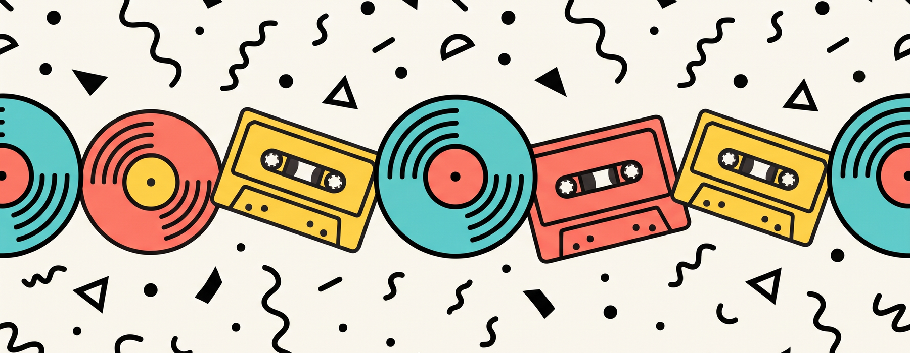
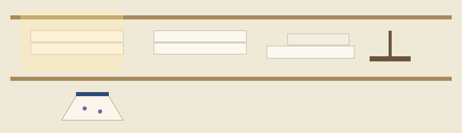

# YouTube Music Extension for SillyTavern

<p align="center"></p>







A SillyTavern extension that adds YouTube Music function tools, backed
by the `ytmusic-api` library (version 4.x). Search tools return real
results; a few tools the library cannot support answer with an explicit
limitation message instead of data (see the tool list below).

## Installation

Requires the SillyTavern staging branch.

Install via the extension installer using the following URL:

```txt
https://github.com/Epsilon0xCell/Extension-YouTube
```


## Authentication

The extension authenticates with a YouTube Music cookie string. There
is no OAuth flow.

### How to get your cookies

1. Log in to [YouTube Music](https://music.youtube.com/) in your browser
2. Open developer tools (F12 or right-click, then Inspect)
3. Go to the Application tab
4. In the sidebar, navigate to Storage, then Cookies, then
   https://music.youtube.com
5. Copy the cookie values and format them as one cookie string with
   entries separated by `; `, for example
   `CONSENT=YES+; VISITOR_INFO1_LIVE=somevalue; ...`

### Signing in

1. Paste the cookie string into the "YouTube Music Cookies" field in
   the extension settings
2. Click "Authenticate"
3. The extension initializes a client with the cookies first and only
   saves them if that succeeds. On success the settings show
   `[Authenticated]`. The library exposes no account endpoint, so your
   account name is not displayed.

The stored expiry is a fixed 30-day estimate counted from sign-in, not
the real expiry of any individual cookie. The extension warns you when
that estimate is within 3 days.

> **Shelf label.** COOKIES SAVED ONLY AFTER A SUCCESSFUL SIGN IN

## Function tools

The extension registers the following function tools, each toggleable
in the extension settings. "Search Songs", "Play Item", and "Get
Current Song" are enabled by default; the rest are disabled by
default.

Working tools, backed by the library:

1. "Search Songs": search for songs by name or artist
2. "Search Artists": search for artists by name
3. "Search Albums": search for albums by title or artist
4. "Play Item": returns a music.youtube.com URL for a song or
   playlist for you to open. It cannot start playback itself.
5. "Get Playlist Items": lists the tracks of a playlist by playlist ID

Tools that report a limitation, because ytmusic-api 4.x provides no
endpoint for them:

6. "Get Current Song": no now-playing or history endpoint exists in
   the library, so the tool explains that it cannot return a song
7. "Get Queue": the library provides no queue access
8. "Get History": the library provides no listening history
9. "Get User Playlists": the library can search public playlists but
   cannot list your library playlists

## Prompt injection

The settings include an injection template with `{{song}}`, `{{artist}}`,
and `{{album}}` macros, plus role, position, and depth controls. At
present nothing is injected: filling the template needs the most
recently played track, and ytmusic-api 4.x has neither a now-playing
nor a history endpoint. The interceptor runs on each generation, clears
any stale injection, and logs why. The template settings are kept so
the feature can resume if the library adds history access.

## Building

```bash
npm install
npm run build
```

The build compiles `src/` with webpack and TypeScript into
`dist/index.js`, the file `manifest.json` loads. `npm run lint` runs
ESLint, and `npx tsc --noEmit` type-checks; both pass. The webpack
build finishes with warnings from the ytmusic-api dependency chain
(it is written for Node and references Node builtins) and a bundle-size
warning; these come from the library, not from this code.

What cannot be verified outside SillyTavern: the settings UI, the
function-tool registration, and live calls against a real YouTube Music
account all need a running SillyTavern with your cookies. The build,
type check, lint, manifest validation, and the pure URL-parsing helpers
in `src/util.ts` are verified headlessly.


## License

AGPL-3.0. See [LICENSE](LICENSE) for more details.
